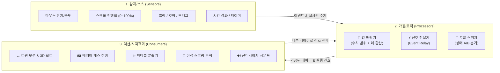
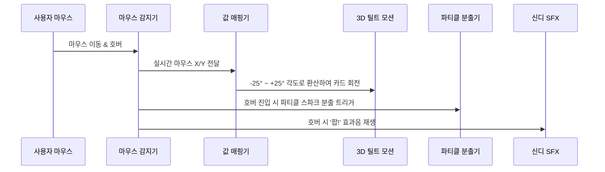

# 🎨 JSPen Studio - 포토샵 기반 인터랙티브 그래픽 & 자바스크립트 생성기 구상안

> **프로젝트 개요**  
> **JSPen Studio**는 **어도비 포토샵(Adobe Photoshop)의 친숙한 조작 체계와 레이어/드로잉 도구**를 웹/데스크톱 캔버스에 이식하고,  
> 사용자가 복잡한 자바스크립트 코딩을 전혀 하지 않아도 되도록 **28종의 내장 모듈 간 유기적인 상호작용 파이프라인(이벤트 체인, 반응형 데이터 스트림, 값 매핑)**을 제공하여,  
> 클릭과 슬라이더 조작만으로 완성된 결과물을 **순수 자바스크립트(Vanilla JS HTML5 Canvas 2D) 코드로 1:1 출력**하는 디자인 전문 데스크톱 애플리케이션입니다.

---

## 1. 🔄 모듈 간 상호작용 아키텍처 (Reactive Module Interplay)

모듈들은 각자 따로 노는 것이 아니라, **[감지 ➔ 가공/매핑 ➔ 액션/시각효과 ➔ 타겟 레이어 전파]** 로 이어지는 **유기적인 리액티브 파이프라인(Reactive Pipeline)**으로 맞물려 작동합니다.



---

## 2. 모듈 간 상호작용 연결 방식 (UI 바인딩)

복잡한 선 잇기(Node Wire) 없이, **모듈 설정 카드의 드롭다운 선택**만으로 모듈끼리 즉시 연결됩니다:

```
[ 📐 값 매핑기 (Value Remapper) ]
├─ 입력 소스 (Input Source):   [ 📜 스크롤 진행률 (0~100%) ▼ ]
├─ 입력 범위 (Input Range):    [ 0 ] ~ [ 100 ]
├─ 출력 타겟 (Output Target):  [ ↔️ 트윈 모션: X 좌표 ▼ ]
└─ 출력 범위 (Output Range):   [ 100px ] ~ [ 700px ]

👉 결과: 마우스 휠을 스크롤하면, 코딩 한 줄 없이 오브젝트가 100px에서 700px까지 부드럽게 횡단 이동!
```

---

## 3. 대표적인 모듈 간 연쇄 상호작용 시나리오 (Chaining Examples)

### 시나리오 1. 마우스 반응형 3D 카드 + 파티클 + 사운드


### 시나리오 2. 스크롤 인터랙티브 패스 주행 (Scroll-Driven Path Motion)
1. **[📜 스크롤 감지기]** 가 사용자의 휠 스크롤 진행도(0% ~ 100%)를 읽음
2. ➔ **[📐 값 매핑기]** 로 전달되어 패스 진행률(0.0 ~ 1.0)로 변환
3. ➔ **[🛤️ 베지어 패스 주행기]** 가 펜 도구로 그린 곡선을 따라 자동차 오브젝트를 정확히 전진시킴
4. ➔ 자동차가 80% 지점에 도달했을 때: **[충돌/영역 감지기]** 가 신호 방출
5. ➔ **[⚡ 신호 전달기]** 가 다음 텍스트 레이어로 신호를 보내, 텍스트의 **[트윈 모션]** (서서히 페이드인) 실행!

### 시나리오 3. 캐릭터와 펫 (Follow Target + Look At + Wiggle)
1. 사용자가 레이어 A(캐릭터)를 **[자유 드래그 모듈]** 로 마우스 이동
2. 레이어 B(펫)의 **[🧲 타겟 추적 모듈]** 이 레이어 A의 좌표를 감지하여 쫀득한 탄성 스프링으로 뒤쫓음
3. 동시에 레이어 B의 **[👀 타겟 조준 모듈]** 이 항상 레이어 A의 중심점을 바라보도록 각도를 실시간 회전
4. 멈춰 서면 레이어 B의 **[유기적 부유 / 흔들림 모듈]** 이 꼬리를 살랑살랑 흔드는 루프 실행

### 시나리오 4. 버튼 클릭 ➔ 단계별 시퀀서 (Action Sequencer)
1. 버튼 클릭 시 **[⏱️ 단계별 시퀀서]** 가 가동:
   * **Step 1 (0.0s ~ 0.15s)**: 버튼 레이어 **[트윈 모션]** (크기 0.95배 꾹 눌림) + **[사운드 모듈]** (찰칵 클릭음)
   * **Step 2 (0.15s ~ 0.3s)**: **[신호 전달기]** 가 팝업창 레이어로 "열려라" 신호 전송
   * **Step 3 (0.3s ~ 0.8s)**: 팝업창 레이어의 **[트윈 모션]** (스프링 이징으로 통통 튀며 화면 중앙에 등장)

---

## 4. 28종 올인원 노코드 기능 모듈 라이브러리 전체 목록

### 📡 1) 감지 및 입력 모듈 (Sensors & Inputs - 9종)
1. **마우스 위치 추적 (Mouse Tracker)**: 커서 X/Y 실시간 추적, 캔버스 상대 좌표, 마우스 이동 속도(가속도)
2. **호버 및 반경 감지 (Hover & Distance Zone)**: 요소 위에 올렸을 때(Hover) 및 N픽셀 반경에 가까워졌을 때(Proximity)
3. **클릭 & 제스처 (Click & Gestures)**: 단순 클릭, 더블 클릭, 롱프레스(누르고 있기), 우클릭, 포인터 다운/업
4. **자유 드래그 (Draggable Object)**: 마우스로 집어서 옮길 수 있게 만들기 (경계 영역 제한, 원위치 복귀 Snap-back 옵션)
5. **스크롤 & 휠 (Scroll & Wheel)**: 마우스 휠 deltaY, 스크롤 진행률(0~100%), 스크롤 방향(Up/Down) 감지
6. **키보드 단축키 (Keyboard Sensor)**: Space, Enter, 방향키, WASD 등 특정 키 누름/뗌 감지
7. **충돌 및 겹침 감지 (Collision & Overlap)**: 다른 레이어와 경계선이 닿거나 겹쳤을 때 감지 (원형/박스)
8. **화면 가시성 (In-View Sensor)**: 스크롤 시 화면 안에 들어왔을 때(In-View) / 나갔을 때(Out-of-View) 트리거
9. **시간 & 타이머 (Timer & Chrono)**: N초 후 1회 실행(Delay), N초마다 주기적 신호(Interval Metronome)

### 🔗 2) 링크, 관계 & 로직 모듈 (Links, Relations & Logic - 7종)
1. **타겟 추적 (Follow Target)**: 대상 B를 지정하여 따라다님 (강체 고정, 탄성 스프링, 뱀 같은 지연 추종)
2. **타겟 조준 (Look At Target)**: 대상 레이어 B(또는 마우스)를 향해 머리(각도)를 실시간 자동 조준 회전
3. **거리 제한 로프 (Distance Constraint)**: 두 레이어 사이의 거리를 일정 거리로 묶어 막대/로프 연결 효과
4. **값 매핑기 (Value Remapper)**: **[코딩 없는 수학!]** 입력 범위 `[A_min ~ A_max]`를 출력 범위 `[B_min ~ B_max]`로 자동 비례 환산
5. **신호 전달기 (Event Relay)**: "내가 특정 상태가 되면 ➔ 대상 레이어 B의 [동작]을 원격 실행"
6. **토글 스위치 (State Toggle)**: 클릭할 때마다 On/Off 상태 전환 및 상태별 외형/위치 자동 스위칭
7. **숫자 카운터 (Counter & Variable)**: 클릭 시 +1, 충돌 시 -1 등 숫자 증감 및 텍스트 레이어 연동

### 🎬 3) 모션 & 시각 효과 모듈 (Motions & Visual FX - 10종)
1. **트윈 보간 모션 (Property Tween)**: 시작값에서 목표값으로 위치/크기/각도/투명도/색상 부드러운 전환
2. **베지어 패스 주행 (Path Follower)**: 펜 도구(`P`)로 그린 임의의 벡터 곡선을 따라 기차처럼 주행 (곡선 방향 자동 정렬)
3. **마우스 3D 틸트 (Parallax 3D Tilt)**: 마우스 위치에 따라 카드가 3D 입체 원근감 있게 기울어지는 고급 웹 효과
4. **파티클 분출기 (Particle Emitter)**: 이동하거나 클릭할 때 반짝이 별, 스파크, 연기 입자 분출
5. **유기적 부유 (Floating Wave)**: 물 위에 뜬 배처럼 위아래/좌우로 부드럽게 둥둥 떠 있는 물결 모션
6. **두근거림 & 숨쉬기 (Pulse & Breathe)**: 심장박동처럼 크기와 투명도가 은은하게 커졌다 작아지는 모션
7. **진동 & 흔들림 (Wiggle & Shake)**: 노이즈 기반 자연스러운 떨림 및 충격 흔들림
8. **자전 및 공전 (Spin & Orbit)**: 제자리 자전 또는 특정 레이어 B를 중심축으로 공전
9. **화면 벽 튕기기 (Bounce off Screen)**: 화면 가장자리 벽에 닿으면 입사각/반사각으로 튕겨나감
10. **색상 순환 (Rainbow Cycle)**: 시간이 지남에 따라 색상이 무지개처럼 서서히 순환

### ⏱️ 4) 타이밍, 시퀀서 & 제어 모듈 (Timing & Sequence - 5종)
1. **동작 시간 & 지연 (Duration & Delay)**: 동작 시간(ms/s) 및 대기 시간 조절
2. **단계별 시퀀서 (Action Sequencer)**: 1단계(이동) ➔ 2단계(대기) ➔ 3단계(회전) ➔ 4단계(복귀) 순차 실행
3. **시차 도미노 (Stagger Delay)**: 여러 레이어가 0.05초 간격을 두고 파도타기하듯 연속 실행
4. **이징 프리셋 (Easing Library)**: Linear, Ease-In-Out, Elastic(고무줄), Bounce(공 튐), Spring(물리 댐핑)
5. **루프 모드 (Loop Mode)**: 1회 실행(Once), 무한 반복(Infinite), 왕복 재생(Ping-Pong)

### 🔊 5) 사운드 & 피드백 모듈 (Audio & Feedback - 2종)
1. **내장 신디사이저 SFX (Web Audio Synth)**: 파일 없이 즉시 뾱, 찰칵, 딩동, 팝, 스위치 클릭음 합성 재생
2. **오디오 파일 재생 (Audio Clip)**: MP3/WAV 파일 지정 및 볼륨/피치 제어

---

## 5. 포토샵형 기본 편집 속성 (우측 인스펙터 상단)

* **변형 (Transform)**: X, Y, Width, Height, 가로세로 비율 고정 링크 자물쇠, 회전 각도 다이얼, 스케일
* **모서리 베벨 (Bevel Chamfer)**: 각진 모서리 모따기 깊이 조절 (0px ~ 50px)
* **코너 라운딩 (Corner Radius)**: 4개 모서리(좌상, 우상, 우하, 좌하) 개별 곡률 지원
* **불투명도 (Opacity & Fill)**: 전체 불투명도 및 칠(Fill) 불투명도 0~100%
* **블렌딩 모드 (Blend Mode)**: Normal, Multiply, Screen, Overlay, Soft Light, Color Dodge 등
* **채우기 & 테두리 (Fill & Stroke)**: 단색 컬러, 선형/방사형 그라디언트, 테두리 두께 및 정렬

---

## 6. 포토샵 표준 도구 모음 (Toolbox)

* ↖ `V` : **이동 도구 (Move Tool)** - 레이어 선택/이동 (`Ctrl` 자동 레이어 감지, `Alt` 드래그 복제)
* ☩ `A` : **직접 선택 도구 (Direct Selection)** - 펜 곡선의 앵커 포인트 및 방향선 핸들 미세 조정
* ✒ `P` : **펜 도구 (Pen Tool)** - 3차 베지어 커브 벡터 드로잉 (`Alt` 핸들 분리, `Ctrl` 앵커 이동)
* 🖌 `B` : **브러시 도구 (Brush Tool)** - 자유형 브러시 스트로크 드로잉 (`[` / `]` 크기 조절)
* 🌈 `G` : **그라디언트 / 페인트 통** - 캔버스 클릭-드래그 선형/방사형 그라디언트 핀 생성 및 영역 채우기
* ⬛ `U` : **도형 / 직선 도구** - 사각형, 베벨 사각형, 원/타원, 다각형, 별, 직선 (`Shift` 정비율, `Alt` 중심점)
* 💉 `I` : **스포이드 도구** - 캔버스 상의 임의의 픽셀 색상 즉시 추출
* 🔤 `T` : **문자 도구** - 텍스트 입력 및 타이포그래피 설정
* ✋ `Space` : **손 도구 (Hand Tool)** - 캔버스 뷰포트 자유 이동 (Pan)
* 🔍 `Alt+휠` : **돋보기 (Zoom)** - 마우스 위치 중심 줌 인/아웃
* 🔄 `Ctrl+T` : **자유 변형 (Free Transform)** - 8방향 바운딩 박스로 크기 조절 및 회전
* 📑 `Ctrl+J` : **레이어 복제** - 선택 레이어 사본 즉시 생성

---

## 7. 순수 자바스크립트 코드 출력 엔진 (Code Generator)

모듈 간의 연결 관계(파이프라인)는 순수 자바스크립트의 **이벤트 리스너 + 수치 매핑 함수 + requestAnimationFrame 렌더링 루프**로 100% 깔끔하게 직렬화되어 출력됩니다:

```javascript
/**
 * JSPen Studio 자동 생성 코드: 모듈 상호작용 체인
 * 파이프라인: [마우스 감지] ➔ [값 매핑기] ➔ [A 3D 틸트] ➔ [B 스프링 추적] ➔ [파티클 분출]
 */
(function() {
  const canvas = document.getElementById('canvas');
  const ctx = canvas.getContext('2d');

  // 상태 파이프라인 버스
  const bus = {
    mouse: { x: canvas.width / 2, y: canvas.height / 2 },
    particles: []
  };

  const Layer_A = { x: 400, y: 300, w: 120, h: 80, bevel: 10, tilt: 0, color: '#38bdf8' };
  const Layer_B = { x: 400, y: 300, w: 40, h: 40, bevel: 6, vx: 0, vy: 0, color: '#f43f5e' };

  // 1. [감지기] ➔ [값 매핑기] 파이프라인
  window.addEventListener('mousemove', e => {
    const r = canvas.getBoundingClientRect();
    bus.mouse.x = e.clientX - r.left;
    bus.mouse.y = e.clientY - r.top;

    // [값 매핑 모듈]: 마우스 X (0~width) ➔ 각도 (-25° ~ +25°)
    Layer_A.tilt = ((bus.mouse.x / canvas.width) - 0.5) * 50;
    Layer_A.x = bus.mouse.x;
    Layer_A.y = bus.mouse.y;

    // [파티클 모듈 트리거]
    bus.particles.push({
      x: bus.mouse.x, y: bus.mouse.y,
      vx: (Math.random() - 0.5) * 4, vy: (Math.random() - 0.5) * 4,
      life: 1, color: '#fbbf24'
    });
  });

  // 2. 애니메이션 프레임 루프 (링크 & 소비자 모듈)
  function loop() {
    // [링크 모듈]: B가 A를 탄성 스프링으로 추적
    const dx = Layer_A.x - Layer_B.x;
    const dy = Layer_A.y - Layer_B.y;
    Layer_B.vx = (Layer_B.vx + dx * 0.08) * 0.85;
    Layer_B.vy = (Layer_B.vy + dy * 0.08) * 0.85;
    Layer_B.x += Layer_B.vx;
    Layer_B.y += Layer_B.vy;

    // 3. 렌더링
    ctx.clearRect(0, 0, canvas.width, canvas.height);

    // 파티클
    for (let i = bus.particles.length - 1; i >= 0; i--) {
      const p = bus.particles[i];
      p.x += p.vx; p.y += p.vy; p.life -= 0.03;
      if (p.life <= 0) { bus.particles.splice(i, 1); continue; }
      ctx.fillStyle = p.color;
      ctx.globalAlpha = p.life;
      ctx.fillRect(p.x, p.y, 4, 4);
    }

    // Layer A (틸트 각도 회전)
    ctx.save();
    ctx.translate(Layer_A.x, Layer_A.y);
    ctx.rotate((Layer_A.tilt * Math.PI) / 180);
    drawBevelRect(ctx, 0, 0, Layer_A.w, Layer_A.h, Layer_A.bevel, Layer_A.color);
    ctx.restore();

    // Layer B
    drawBevelRect(ctx, Layer_B.x, Layer_B.y, Layer_B.w, Layer_B.h, Layer_B.bevel, Layer_B.color);

    requestAnimationFrame(loop);
  }

  function drawBevelRect(ctx, x, y, w, h, bevel, color) {
    ctx.save();
    ctx.fillStyle = color;
    const hw = w / 2, hh = h / 2, b = Math.min(bevel, hw, hh);
    ctx.beginPath();
    ctx.moveTo(x - hw + b, y - hh);
    ctx.lineTo(x + hw - b, y - hh);
    ctx.lineTo(x + hw, y - hh + b);
    ctx.lineTo(x + hw, y + hh - b);
    ctx.lineTo(x + hw - b, y + hh);
    ctx.lineTo(x - hw + b, y + hh);
    ctx.lineTo(x - hw, y + hh - b);
    ctx.lineTo(x - hw, y - hh + b);
    ctx.closePath();
    ctx.fill();
    ctx.restore();
  }

  requestAnimationFrame(loop);
})();
```
